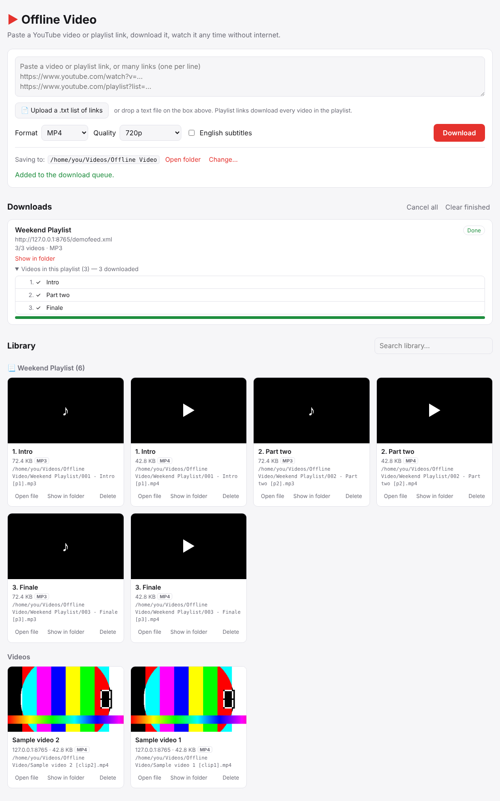

# ▶ Offline Video

[](https://github.com/mdzaman/Offline-video/actions/workflows/ci.yml)
[](https://github.com/mdzaman/Offline-video/releases/latest)
[](LICENSE)

Download YouTube videos **or whole playlists** to your computer and watch them later without an internet connection, all from a simple page in your web browser.



## Features

- **Any kind of link:** a single video, a playlist (every video in it is downloaded), or many links at once, one per line, comma separated, or mixed in with other text. Duplicates are ignored.
- **Upload a list:** pick a `.txt` file of links (or drag it onto the link box) and every link in it is queued.
- **Formats:** video as **MP4, MKV, WebM, MOV, AVI, MPEG**, or audio only as **MP3, M4A, WAV, FLAC, Opus, OGG**. Quality: best, 1080p, 720p, 480p or 360p. Optional English subtitles. You can keep the same video in several formats.
- **A queue with live progress:** speed, time left, and for playlists a list of every video with its status (waiting, downloading, done, already downloaded, failed and why). Cancel one download or all of them.
- **Smart re-downloads:** adding a playlist again only fetches the videos you don't have yet, which is handy for playlists that keep growing.
- **Your files, your folder:** the page shows where files are saved, lets you change the folder, and has **Open file** and **Show in folder** (Finder / Explorer) buttons for every download.
- **Built-in library and player:** thumbnails, search, playlists grouped together, next/previous, autoplay, subtitles, and resume where you left off.

Powered by [yt-dlp](https://github.com/yt-dlp/yt-dlp) and [Flask](https://flask.palletsprojects.com/). It runs entirely on your own computer; nothing is uploaded anywhere.

---

## Contents

1. [Option A: download the ready-made app](#option-a-download-the-ready-made-app-easiest)
2. [Option B: run from the source code on GitHub](#option-b-run-from-the-source-code-on-github)
3. [Option C: install as a command with pipx](#option-c-install-as-a-command-with-pipx)
4. [Install FFmpeg and Deno](#install-ffmpeg-and-deno-needed-for-full-quality)
5. [How to use it](#how-to-use-it)
6. [Updating](#updating)
7. [Troubleshooting](#troubleshooting)
8. [Command-line options](#command-line-options)
9. [For developers](#for-developers)
10. [Publishing a new version on GitHub](#publishing-a-new-version-on-github)
11. [Putting your own copy on GitHub](#putting-your-own-copy-on-github)

---

## Option A: download the ready-made app (easiest)

No Python needed.

1. Open the **[latest release](https://github.com/mdzaman/Offline-video/releases/latest)** page.
2. Under **Assets**, download the file for your computer:

   | Your computer | File |
   |---|---|
   | Mac with Apple silicon (M1, M2, M3, M4) | `offline-video-macos-apple-silicon.zip` |
   | Windows 10 / 11 | `offline-video-windows.zip` |
   | Linux (64-bit) | `offline-video-linux.zip` |

   On an Intel Mac, use [Option B](#option-b-run-from-the-source-code-on-github). (Not sure which Mac you have? Apple menu → **About This Mac** → *Chip*.)
3. Unzip it. You get a single file called `offline-video` (`offline-video.exe` on Windows). Move it anywhere you like, e.g. Applications or your Desktop.
4. **[Install FFmpeg and Deno](#install-ffmpeg-and-deno-needed-for-full-quality)** (one time).
5. Double-click `offline-video`. A small window opens showing the app's log, and your browser opens the app at <http://127.0.0.1:8000>. **Keep that window open while you use the app**; close it to quit.

**First launch on a Mac:** macOS will say the app "can't be opened because Apple cannot check it", because it isn't signed by Apple. Right-click (or Control-click) the file → **Open** → **Open**. You only need to do this once. If that option doesn't appear, open **System Settings → Privacy & Security** and click **Open Anyway**.

**First launch on Windows:** if "Windows protected your PC" appears, click **More info → Run anyway**.

Downloads are saved to `Movies/Offline Video` (Mac) or `Videos/Offline Video` (Windows/Linux) in your home folder until you change it.

## Option B: run from the source code on GitHub

Works on any Mac (including Intel), Windows or Linux computer with Python 3.10 or newer.

### 1. Install the tools (one time)

**Mac:** install [Homebrew](https://brew.sh) if you don't have it, then in **Terminal**:

```bash
brew install python git ffmpeg deno
```

**Windows:** in **PowerShell** or **Command Prompt**:

```bat
winget install Python.Python.3.12 Git.Git Gyan.FFmpeg DenoLand.Deno
```

Then close and reopen the window so Windows finds the new programs.

**Linux (Debian/Ubuntu):**

```bash
sudo apt install python3 python3-venv git ffmpeg
curl -fsSL https://deno.land/install.sh | sh
```

### 2. Get the code

```bash
git clone https://github.com/mdzaman/Offline-video.git
cd Offline-video
```

No Git? On the [repository page](https://github.com/mdzaman/Offline-video) click the green **Code** button → **Download ZIP**, unzip it and open a terminal in that folder.

### 3. Start it

Mac / Linux:

```bash
./run.sh
```

Windows (or double-click `run.bat` in File Explorer):

```bat
run.bat
```

The first run takes a minute: it creates a private Python environment in `.venv` and installs what the app needs. Your browser then opens <http://127.0.0.1:8000>. **Keep the terminal window open while you use the app**; press **Ctrl+C** or close it to quit.

When run this way, downloads go to the `downloads` folder inside the project until you change it.

Next time you only need to open a terminal and run:

```bash
cd Offline-video
./run.sh            # Windows: run.bat
```

## Option C: install as a command with pipx

If you use [pipx](https://pipx.pypa.io/):

```bash
pipx install git+https://github.com/mdzaman/Offline-video.git
offline-video
```

## Install FFmpeg and Deno (needed for full quality)

- **FFmpeg** joins YouTube's separate video and audio streams. Without it you only get the single-file versions YouTube offers (often 360p–720p MP4), and no format conversion. The app still works and shows a yellow warning until it is installed.
- **Deno** is used by yt-dlp to read YouTube pages fully. Without it some formats may be missing.

| | Command |
|---|---|
| Mac | `brew install ffmpeg deno` |
| Windows | `winget install Gyan.FFmpeg DenoLand.Deno`, then restart the app |
| Linux | `sudo apt install ffmpeg` and `curl -fsSL https://deno.land/install.sh \| sh` |

`run.sh` offers to install both with Homebrew on a Mac, and `run.bat` installs them with winget on Windows.

## How to use it

1. **Choose the format and quality** (top of the form). Audio formats ignore the quality setting.
2. **Add links**, any of these ways:
   - Paste one video link, e.g. `https://www.youtube.com/watch?v=…` or `https://youtu.be/…`
   - Paste a playlist link, e.g. `https://www.youtube.com/playlist?list=…`. Every video in it is queued.
   - Paste many links at once (one per line, or separated by commas or spaces).
   - Click **📄 Upload a .txt list of links**, or drag a text file onto the link box. Any text file works; the app finds the links in it.

   Then click **Download** (uploads are queued immediately).
3. **Watch progress** under *Downloads*. For a playlist, click *Videos in this playlist* to see each video's status. Downloads run one at a time; use **Cancel** or **Cancel all** to stop.
4. **Watch offline** in the *Library*: click a thumbnail to play it in the browser (next/previous, autoplay, subtitles, resumes where you stopped), or use:
   - **Open file**: plays it in your computer's default player (QuickTime, VLC, Windows Media Player…)
   - **Show in folder**: shows the file in Finder / File Explorer
   - **Delete**: removes the file from your computer
5. **Change where files are saved** with **Saving to → Change…**. The choice is remembered.

Good to know:

- A link like `watch?v=…&list=…` (a video opened from a playlist) downloads **the whole playlist**. To get only that video, delete everything from `&list=` onwards.
- Videos you already have (in the same format) are skipped, so re-adding a playlist only fetches new videos.
- Browsers play MP4, WebM, MOV (Safari) and the audio formats. MKV, AVI and MPEG open in your computer's player instead; [VLC](https://www.videolan.org/) plays everything.
- AVI and MPEG need the video to be re-encoded, which takes much longer than other formats.

Files are organised like this:

```
Offline Video/
├── Some video [dQw4w9WgXcQ].mp4          # single videos
├── Some video [dQw4w9WgXcQ].mp3          # the same video in another format
├── Some video [dQw4w9WgXcQ].jpg          # thumbnail
├── Some video [dQw4w9WgXcQ].info.json    # details used by the library
└── My Playlist/                           # one folder per playlist, in playlist order
    ├── 001 - First video [abc123].mp4
    └── 002 - Second video [def456].mp4
```

## Updating

- **Ready-made app:** download the newest file from the [Releases page](https://github.com/mdzaman/Offline-video/releases) and replace the old one. Your downloads and settings are kept.
- **From source:** stop the app, then `git pull` and `./run.sh` (Windows: `git pull` then `run.bat`). `run.sh`/`run.bat` also update yt-dlp each time they start.
- **pipx:** `pipx upgrade offline-video` (or `pipx reinstall offline-video` to also get the newest yt-dlp).

YouTube changes often. **If downloads suddenly start failing, update first**: that installs the latest yt-dlp, which usually fixes it.

## Troubleshooting

| Problem | Fix |
|---|---|
| Yellow "FFmpeg is not installed" banner, or low quality | [Install FFmpeg](#install-ffmpeg-and-deno-needed-for-full-quality), then reload the page. |
| Downloads fail with "Sign in to confirm you're not a bot", "Video unavailable" or similar | Update (see above). Private, members-only and age-restricted videos can't be downloaded. |
| "This site can't be reached" at 127.0.0.1:8000 | The app isn't running: start it again (Option A, B or C) and keep its window open. |
| Port 8000 is used by another program | The app automatically uses the next free port (8001, 8002…) and opens it for you. You can also choose one: `./run.sh --port 9000`. |
| A video won't play in the browser | Use **Open file** to play it in your computer's player. |
| **Open file** / **Show in folder** says it only works on the same computer | These buttons only work in a browser on the computer that runs the app. |
| Mac: "cannot be opened because the developer cannot be verified" | Right-click the app → **Open** → **Open** (once). |
| Windows: `winget` not found | Install "App Installer" from the Microsoft Store, or install [FFmpeg](https://www.gyan.dev/ffmpeg/builds/) and [Python](https://www.python.org/downloads/) manually. |

## Command-line options

```text
offline-video [--port 8000] [--host 127.0.0.1] [--dir FOLDER] [--workers 1] [--no-browser] [--version]
```

Use the same options with `./run.sh`, `run.bat` or `python -m offline_video`.

- `--dir`: folder to save downloads to (also settable on the page, or with the `OFFLINE_VIDEO_DIR` environment variable). The folder chosen on the page is stored in `~/.offline_video.json`.
- `--workers`: how many downloads run at the same time.
- `--host 0.0.0.0`: lets phones and other devices on your home network use the app at `http://<this-computer's-IP>:8000`. There is no password, so only do this on a network you trust. Opening files and changing the folder are always limited to the computer itself.

## For developers

```
offline_video/
├── app.py            # Flask web server and API
├── downloader.py     # download queue, yt-dlp options, format conversion, library
├── templates/        # the page
└── static/           # JavaScript and CSS
tests/test_app.py     # end-to-end tests (local HTTP server, no YouTube needed)
packaging/launcher.py # entry point for the standalone apps
.github/workflows/    # ci.yml (tests on every push), release.yml (builds the apps)
```

Set up and run the tests:

```bash
python -m venv .venv
source .venv/bin/activate        # Windows: .venv\Scripts\activate
pip install -e ".[dev]"
python -m pytest
```

FFmpeg must be installed for the tests. They use generated clips served from a local web server, so they don't need YouTube access.

To contribute: fork the repository on GitHub, create a branch, make your change with a test, push it to your fork and open a pull request. The **Tests** workflow runs on macOS, Windows and Linux for every pull request.

## Publishing a new version on GitHub

Releases are built automatically by GitHub Actions ([`.github/workflows/release.yml`](.github/workflows/release.yml)):

1. Update `__version__` in `offline_video/__init__.py` (e.g. `1.1.0`) and commit it.
2. Create and push a tag with the same number:

   ```bash
   git tag v1.1.0
   git push origin main v1.1.0
   ```
3. Open the repository's **Actions** tab and wait for the **Release** workflow (about 5 minutes). It builds the Mac, Windows and Linux apps and publishes them on the **Releases** page, with release notes.

You can also run the workflow by hand (**Actions → Release → Run workflow**) to build the apps as downloadable artifacts without publishing a release.

## Putting your own copy on GitHub

- **Easiest:** click **Fork** at the top of the [repository page](https://github.com/mdzaman/Offline-video). You get your own copy, and the workflows work in it too. To publish releases from your fork, enable workflows under its **Actions** tab, then push a tag as above.
- **As a new repository:** create an empty repository on GitHub (**+ → New repository**, without a README), then:

  ```bash
  git clone https://github.com/mdzaman/Offline-video.git
  cd Offline-video
  git remote set-url origin https://github.com/<you>/<your-repo>.git
  git push -u origin main
  ```

## Please note

Only download videos you have the right to save: your own uploads, Creative Commons content, or where the creator and YouTube allow it. YouTube's Terms of Service restrict downloading in many cases; YouTube Premium also offers official offline viewing in its apps. This project is not affiliated with YouTube or Google.

## License

[MIT](LICENSE)
